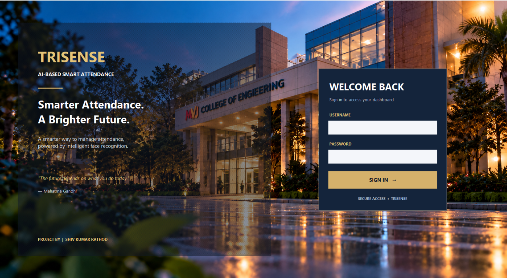

\# TRISENSE - AI-Based Smart Attendance Management System


\*\*Developed by:\*\* SHIV KUMAR RATHOD


\## 1. Project Overview


TRISENSE is a Python desktop application designed to manage student attendance using face recognition. It includes role-based login, attendance sessions, attendance records, student attendance summaries, and condonation request management.


\## 2. Main Features


\- Face-based student registration and recognition.

\- Attendance session creation and attendance marking.

\- Duplicate attendance prevention for the same student and session.

\- Admin, reviewer, and student login roles.

\- Student account creation and authentication.

\- Student attendance calendar and subject-wise summaries.

\- Student condonation requests.

\- Reviewer approval or rejection of condonation requests.

\- Attendance summaries and session reports for administrators.

\- SQLite database for persistent records.


\## 3. Technologies Used


\- Python

\- Tkinter

\- OpenCV

\- InsightFace and ONNX Runtime

\- NumPy

\- SQLite

\- Pytest


\## 4. Requirements


\- Windows

\- Python 3.12 recommended

\- A webcam for live face recognition

\- Project dependencies installed in the virtual environment


\## 5. Setup and Run


Open PowerShell in the project directory.


Activate the virtual environment:


```powershell

.\\.venv\\Scripts\\Activate.ps1

```


Install dependencies if they are not already installed:


```powershell

python -m pip install -r requirements.txt

```


Start the application:


```powershell

python main.py

```


\## 6. User Roles


\### Administrator


Manages student registration, student accounts, attendance sessions, attendance summaries, and session reports. Administrators can also manage condonation requests.


\### Reviewer


Reviews pending condonation requests and records approval or rejection decisions.


\### Student


Views personal attendance information, the attendance calendar, subject-wise summaries, and condonation requests. Students can submit their own condonation requests.


\## 7. Testing


Run the automated tests:


```powershell

python -m pytest -q --ignore=test\_live\_attendance.py

```


Check Python syntax:


```powershell

python -m compileall -q .\\app .\\main.py

```


Check database integrity:


```powershell

python -c "import sqlite3; c=sqlite3.connect('data/attendance.db'); print(c.execute('PRAGMA integrity\_check').fetchone()\[0]); c.close()"

```


The database integrity check should print `ok`.


The live webcam test is excluded from the automated test command because it requires a suitable registered student, a webcam, and manual interaction.


\## 8. Database and Backup


The application database is stored at:


`data/attendance.db`


\*\*Important:\*\* Back up the database before making schema changes or performing database maintenance. Do not delete or reset the database during normal operation because it contains student accounts, attendance records, and review history.


\## 9. Operational Notes


\- Keep student records and face data accurate.

\- Test the webcam and lighting before using the system for actual attendance.

\- Verify attendance records after each session.

\- Protect account credentials and database backups.

\- Test the complete workflow with authorized users before institutional deployment.


\## 10. Project Status


The application includes authentication, role-based dashboards, student account management, attendance processing, an attendance calendar, and condonation workflows. Final institutional handover should include verification of the live webcam workflow, role permissions, attendance calculations, database backup and restore, and the institution's deployment requirements.


---

## Application Screenshots

### TRISENSE Login Screen

The login interface features TRISENSE branding and a campus-inspired background.



